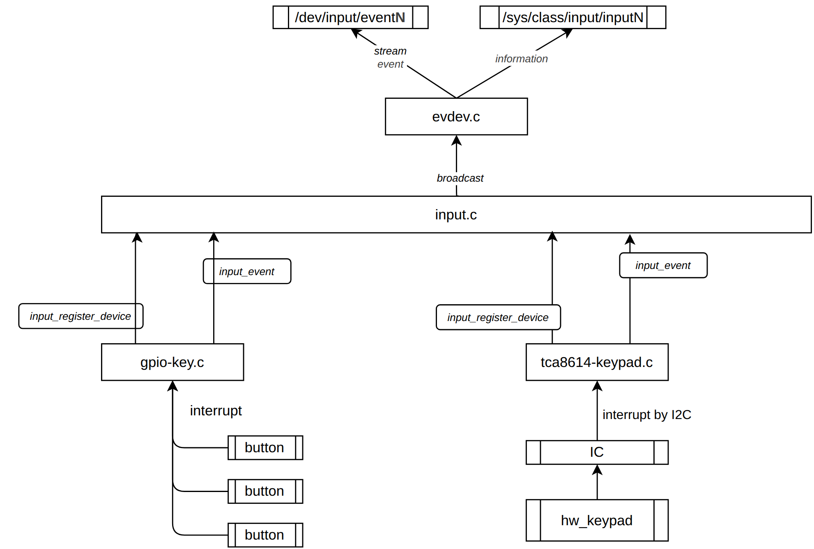

# KEY subsystem


- Key drivers (`gpio_keys.c`, keypad IC drivers, ...) register an `input_dev` to `input.c`.
- `input.c` broadcasts events to handlers (`evdev.c`), which expose them to user space (see [Expose to user space](#expose-to-user-space)):
  - `/dev/input/eventN`: event stream
  - `/sys/class/input/inputN`: device information / capabilities

## 1. Driver flow

### Receive event via interrupt
- `gpio-keys`: each button has its own GPIO → IRQ (`gpio_to_irq`), debounced in the driver.
- Keypad IC (I2C): one IRQ line from the IC → the handler reads IC registers over I2C to find which key changed (must use a threaded IRQ since I2C can sleep).

### Notify the input subsystem
```c
/* probe */
input = devm_input_allocate_device(dev);
input_set_capability(input, EV_KEY, KEY_POWER);   /* declare key capability */
input_set_capability(input, EV_KEY, KEY_VOLUMEUP);   /* declare key capability */
input_register_device(input); /* register the input device */
/* request IRQ */
devm_request_threaded_irq(dev, irq, NULL, key_irq_thread,
                          IRQF_ONESHOT | IRQF_TRIGGER_FALLING, "my-key", priv);

/* IRQ thread */
static irqreturn_t key_irq_thread(int irq, void *data)
{
    ...
    input_event(input, EV_KEY, KEY_POWER, pressed);   /* = input_report_key() */
    input_sync(input);                                /* EV_SYN/SYN_REPORT: end of one event frame */
    return IRQ_HANDLED;
}
```
- Without `input_sync()` user space will not process the frame.
- Events for keys not declared with `input_set_capability()` are dropped.

### One channel for multiple keys
- One `input_dev` (→ one `/dev/input/eventN`) can register many key codes.
- One hardware channel can also serve many keys:
  - Keypad matrix IC: one IRQ, the key is decoded from IC registers.
  - `adc-keys`: one ADC channel, each key maps to a different voltage level (`press-threshold-microvolt` in DT).

### Expose to user space
After `input_register_device()`, each device appears to user space through 2 channels:

| Channel | Created by | Purpose |
|---------|-----------|---------|
| `/dev/input/eventN` | `evdev.c` (char device) | Stream of `struct input_event` (`time`, `type`, `code`, `value`), read with `read()`/`epoll` |
| `/sys/class/input/inputN/` | `input.c` (sysfs) | Read-only device info and capabilities, no events |

`/dev/input/eventN`, the event stream:
```bash
getevent -lt /dev/input/event0
# [ 1234.567890] EV_KEY  KEY_POWER   DOWN
# [ 1234.567890] EV_SYN  SYN_REPORT  00000000
```

`/sys/class/input/inputN/`, the capabilities:
```bash
cat /sys/class/input/input0/name               # device name (from driver)
cat /sys/class/input/input0/id/{bustype,vendor,product,version}
cat /sys/class/input/input0/capabilities/ev    # bitmap of event types, e.g. 3 = EV_SYN | EV_KEY
cat /sys/class/input/input0/capabilities/key   # bitmap of key codes from input_set_capability()
ls  /sys/class/input/input0/                   # event0/ subdir links inputN ↔ eventN
```
- Bitmaps are hex words, highest word first: bit `n` set means code `n` is supported (e.g. bit 116 = `KEY_POWER`).
- The same info can also be read from the event fd with `ioctl`: `EVIOCGNAME`, `EVIOCGID`, `EVIOCGBIT(EV_KEY, ...)`, `EVIOCGKEY` (current pressed state).

## 2. User space commands

| Command | Purpose |
|---------|---------|
| `getevent -l` | Dump events with readable names (`EV_KEY KEY_POWER DOWN`) |
| `getevent -i` | Detailed device info (name, bus, version, props) |
| `sendevent <dev> <type> <code> <value>` | Inject raw event into a device |
| `input keyevent <KEYCODE>` | Android: inject key at framework level (no driver involved) |
| `cat /proc/bus/input/devices` | Map device name ↔ `eventN`, handlers, capability bitmask |
| `cat /proc/interrupts \| grep -i key` | Check that the key IRQ actually fires |
| `dumpsys input` | Android: devices seen by `InputReader`, key layout (`.kl`) used |

Simulate a power key press with `sendevent` (`EV_KEY = 1`, `KEY_POWER = 116`, `EV_SYN = 0`):
```bash
sendevent /dev/input/event0 1 116 1   # press
sendevent /dev/input/event0 0 0 0     # sync
sendevent /dev/input/event0 1 116 0   # release
sendevent /dev/input/event0 0 0 0     # sync
```

## 3. User space application: use `epoll`
- Don't busy-poll `read()`; block in `epoll_wait()` and only read when the fd is readable.
- One `epoll` instance can watch many `/dev/input/eventN` (Android `EventHub` does this, plus `inotify` on `/dev/input` for hotplug).

```c
int fd = open("/dev/input/event0", O_RDONLY | O_NONBLOCK);
int ep = epoll_create1(EPOLL_CLOEXEC);
struct epoll_event ev = { .events = EPOLLIN, .data.fd = fd };
epoll_ctl(ep, EPOLL_CTL_ADD, fd, &ev);

for (;;) {
    struct epoll_event out[8];
    int n = epoll_wait(ep, out, 8, -1);
    for (int i = 0; i < n; i++) {
        struct input_event ie;
        while (read(out[i].data.fd, &ie, sizeof(ie)) == sizeof(ie)) {
            if (ie.type == EV_KEY)
                printf("code %d value %d\n", ie.code, ie.value);
        }
    }
}
```
