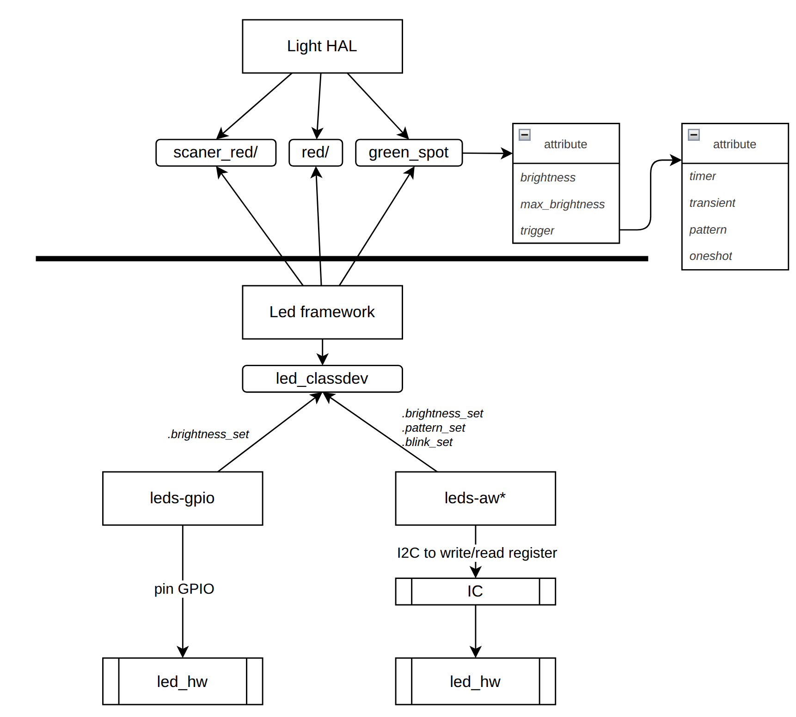

# LED subsystem


- Each LED is a `led_classdev`, exported to `/sys/class/leds/<led_name>/`.
- Basic attributes: `brightness`, `max_brightness`, `trigger`.
- Driver callbacks: `.brightness_set` (required), `.blink_set` (HW blink), `.pattern_set` (HW pattern).
- Selecting a trigger creates extra trigger-specific attributes in the same directory.

```bash
cat /sys/class/leds/<led_name>/trigger        # list triggers, [xxx] is the active one
echo none > /sys/class/leds/<led_name>/trigger # remove trigger
```

## 1. Trigger modes

| Trigger | Description | Attributes |
|---------|-------------|------------|
| `none` | Manual control via `brightness` | – |
| `timer` | Continuous on/off blinking | `delay_on`, `delay_off` |
| `oneshot` | One blink per activation | `delay_on`, `delay_off`, `invert`, `shot` |
| `transient` | Turn on/off for a period, then return to previous state | `activate`, `duration`, `state` |
| `pattern` | Run a brightness sequence over time (blink, breathing) | `pattern`, `hw_pattern`, `repeat` |
| `heartbeat` | Heartbeat-like blink, rate follows CPU load | `invert` |

### Enable trigger mode
```config
CONFIG_LEDS_TRIGGER_PATTERN
CONFIG_LEDS_TRIGGER_TIMER
CONFIG_LEDS_TRIGGER_ONESHOT
CONFIG_LEDS_TRIGGER_HEARTBEAT
CONFIG_LEDS_TRIGGER_TRANSIENT
```

## 2. Usage

### timer
```bash
echo timer > /sys/class/leds/<led_name>/trigger
echo 500 > /sys/class/leds/<led_name>/delay_on   # on time (ms)
echo 500 > /sys/class/leds/<led_name>/delay_off  # off time (ms)
```
- If the driver implements `.blink_set` → blinking is done in HW, otherwise the kernel uses a software timer.

### oneshot
```bash
echo oneshot > /sys/class/leds/<led_name>/trigger
echo 100 > /sys/class/leds/<led_name>/delay_on   # on time
echo 100 > /sys/class/leds/<led_name>/delay_off  # off time afterwards
echo 0 > /sys/class/leds/<led_name>/invert
# 0 = LED normally off, lights up only on shot
# 1 = LED normally on, turns off only on shot
echo 1 > /sys/class/leds/<led_name>/shot         # fire one blink
```

### transient
```bash
echo transient > /sys/class/leds/<led_name>/trigger
echo 1 > /sys/class/leds/<led_name>/state        # state while active (1 = on)
echo 2000 > /sys/class/leds/<led_name>/duration  # ms
echo 1 > /sys/class/leds/<led_name>/activate     # start; returns to previous state after duration
```

### pattern
```bash
echo pattern > /sys/class/leds/<led_name>/trigger
echo "255 500 255 0 0 500 0 0" > /sys/class/leds/<led_name>/pattern
echo -1 > /sys/class/leds/<led_name>/repeat      # -1 = repeat forever
```

## 3. `pattern` / `hw_pattern` / `repeat` parameters

### `pattern` (software)
A series of `<brightness> <duration_ms>` pairs:
```
brightness_1 duration_1 brightness_2 duration_2 ...
```
- The LED goes from `brightness_i` → `brightness_i+1` **linearly** over `duration_i` (the kernel computes the intermediate steps).
- `duration = 0` → jump to the next value immediately (no gradual change).
- To hold a brightness level: two consecutive pairs with the same brightness.
- The number of values must be even; writing a malformed pattern deactivates the running one.

| Example | Result |
|---------|--------|
| `255 500 255 0 0 500 0 0` | Square blink: on 500ms, off 500ms |
| `0 1000 255 1000` | Breathing: fade in 1s, fade out 1s |
| `255 1000 0 0` | Start at 255, fade to 0 over 1s, then jump back to 255 |

### `hw_pattern` (hardware)
- Same `<brightness> <duration>` pair format, but passed directly to the driver via `.pattern_set` → the IC runs it autonomously (e.g. `leds-aw*` chips breathing via I2C registers), no CPU wake-up needed.
- Only present when the driver implements `.pattern_set`.
- Semantics and limits (number of pairs, valid durations, ramp support) **depend on each driver/IC** → see `Documentation/leds/leds-<chip>.rst` or the driver source.
- Writing `hw_pattern` deactivates any running software `pattern`, and vice versa.

### `repeat`
- Number of pattern repetitions; `-1` = forever. `0` and other negative values are invalid.
- Changing `repeat` stops the running pattern → write `repeat` **first**, then `pattern`/`hw_pattern`.
