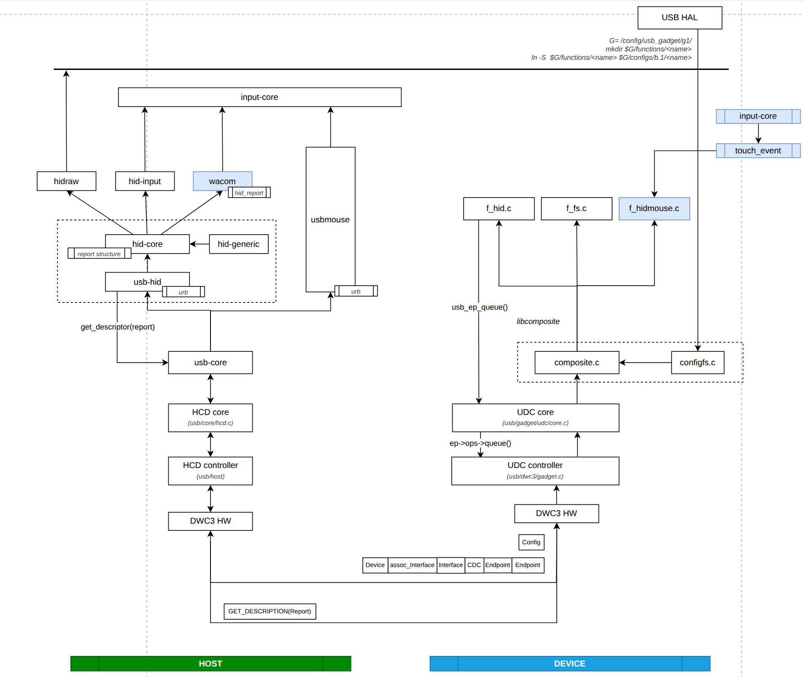
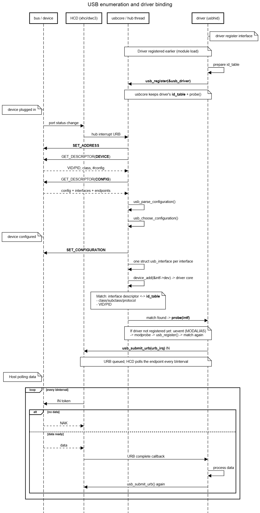
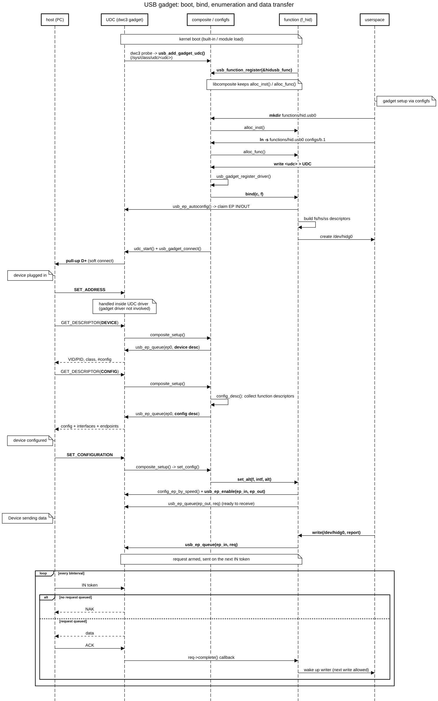

# USB framework

## Architecture


## Sequence diagram
### Host mode


### Device mode


## Basic concepts
### Roles
- **Host** owns the bus: it supplies VBUS, assigns addresses and schedules every transfer. A **device** never talks first, it only answers the host's tokens. The only exception is **remote wakeup**: a suspended device may signal resume on the bus (e.g. key press), if the host enabled it with `SET_FEATURE(DEVICE_REMOTE_WAKEUP)`.
- **Hub** fans out ports, host + hubs form a tiered star. The HCD exposes a virtual **root hub**, so the root ports are handled by the same hub driver as an external hub.
- **DRD / OTG**: one controller (e.g. dwc3) that can be either role. Role comes from DT `dr_mode` (`host` / `peripheral` / `otg`) or is switched at runtime by `usb_role_switch` (usually driven by Type-C CC: DFP → host, UFP → device).

| | Host mode | Device mode |
| --- | --- | --- |
| Controller driver | HCD (xhci-hcd) | UDC (dwc3 gadget) |
| Core | usbcore + hub driver | udc-core + composite (libcomposite) |
| Class driver | `usb_driver` (usbhid) | `usb_function` (f_hid) |
| Transfer unit | `struct urb` | `struct usb_request` |
| Submit / cancel | `usb_submit_urb()` / `usb_kill_urb()` | `usb_ep_queue()` / `usb_ep_dequeue()` |
| Endpoint handle | pipe (`usb_rcvintpipe()`) | `struct usb_ep` |
| Entry point | `probe(intf)` | `bind()` then `set_alt()` |

### Device model
```
device                  one address on the bus (1..127, 0 = default address after reset)
└── configuration       selected by SET_CONFIGURATION, only one active at a time
    └── interface       one function (HID, mass storage...) → one driver binds here
        └── alt setting same interface, different endpoint set / bandwidth (SET_INTERFACE)
            └── endpoint one-way data pipe
```
- **Endpoint 0** always exists, is bidirectional, only does control transfers and works before any configuration is selected (used for enumeration).
- Other endpoints: number 1..15, direction in bit 7 of `bEndpointAddress` (`0x81` = EP1 IN, `0x01` = EP1 OUT).
- **IN / OUT are always named from the host side**: IN = device → host, OUT = host → device.

### Transactions and handshakes
A transfer is split into transactions of at most `wMaxPacketSize` bytes. Each transaction is: token → data → handshake.
- **Token** (always from host): `SETUP` / `IN` / `OUT` + device address + endpoint number.
- **Data**: `DATA0` / `DATA1` alternate (data toggle), so the receiver can drop a duplicate when an ACK was lost and the packet was resent.
- **Handshake**:
	- `ACK`: received OK
	- `NAK`: not ready now, host retries later. This is normal flow control, not an error
	- `STALL`: endpoint halted or request not supported
		- on EP0 (protocol stall): only fails the current request, cleared automatically by the next SETUP
		- on other endpoints (functional stall): stays until the host clears it (`CLEAR_FEATURE(ENDPOINT_HALT)`, `usb_clear_halt()`)

### Transfer types
| Type | Idea | Guarantee | Retry on error | Typical use |
| --- | --- | --- | --- | --- |
| Control | Ask the device about itself and configure it | Delivery | Yes | Enumeration, class requests (`usb_control_msg`) |
| Bulk | Move a big chunk of data correctly, whenever the bus is free | Delivery, no latency bound | Yes | Mass storage, CDC data |
| Interrupt | Host polls the endpoint at a fixed period | Delivery | Yes (next period) | HID input (mouse, keyboard) |
| Isochronous | Data on a fixed period, correctness traded for timing | Bandwidth/latency, **no** delivery | No | Audio, video |

### Control transfer
Every control transfer (on EP0 for all enumeration requests) has 3 stages:
```
SETUP  : host sends the 8-byte request (usb_ctrlrequest)
DATA   : optional, wLength bytes, direction from bit 7 of bRequestType
STATUS : zero-length packet, confirms the whole request
         direction opposite to DATA, or IN (device → host) when there is no DATA stage
```
```c
struct usb_ctrlrequest {        /* include/uapi/linux/usb/ch9.h */
	__u8   bRequestType;    /* D7 direction | D6..5 type: standard/class/vendor | D4..0 recipient: device/interface/endpoint */
	__u8   bRequest;        /* GET_DESCRIPTOR, SET_CONFIGURATION, HID GET_REPORT ... */
	__le16 wValue;          /* request argument, e.g. descriptor type + index */
	__le16 wIndex;          /* interface or endpoint number when recipient != device */
	__le16 wLength;         /* length of the DATA stage */
};
```

| Standard request | bRequest | Meaning | Device mode: handled by |
| --- | --- | --- | --- |
| GET_STATUS | 0 | Self powered, remote wakeup, endpoint halted | UDC driver (dwc3) |
| CLEAR_FEATURE / SET_FEATURE | 1 / 3 | Endpoint halt, remote wakeup | UDC driver (dwc3) |
| SET_ADDRESS | 5 | Assign the bus address | UDC driver (hardware) |
| GET_DESCRIPTOR | 6 | Read device / config / string descriptor | composite |
| GET/SET_CONFIGURATION | 8 / 9 | Select the configuration | composite → `set_alt()` of every function |
| GET/SET_INTERFACE | 10 / 11 | Select an alternate setting | composite → `set_alt()` of that function |

**Class / vendor requests** (HID `GET_REPORT`, `SET_IDLE`...) are not understood by the core: they are routed to the driver that owns the interface given in `wIndex`.

## 1. Descriptors

```
usb_device_descriptor               (product information: vendor, product, USB version)
usb_config_descriptor               (device configuration)
usb_interface_assoc_descriptor      (interfaces belong to the same function)
usb_interface_descriptor            (one function of the device)
hid_descriptor (class descriptor)   (extra info defined by that class, e.g. HID, CDC)
usb_endpoint_descriptor             (the data pipes: direction, transfer type, size, speed)
```

| Descriptor | bDescriptorType | Struct | Parsed by | Meaning |
| --- | --- | --- | --- | --- |
| DEVICE | 1 | `usb_device_descriptor` | `usb_get_device_descriptor()` | VID/PID, USB version, EP0 size |
| CONFIG | 2 | `usb_config_descriptor` | `usb_get_configuration()` | Power budget, number of interfaces |
| INTERFACE ASSOCIATION | 11 | `usb_interface_assoc_descriptor` | `usb_parse_configuration()` | Grouped interfaces (one function) |
| INTERFACE | 4 | `usb_interface_descriptor` | `usb_parse_interface()` | Class/subclass/protocol → driver matching |
| ENDPOINT | 5 | `usb_endpoint_descriptor` | `usb_parse_endpoint()` | Direction, transfer type, max packet, interval |
| HID CLASS | 33 (0x21) | `hid_descriptor` | `usbhid` | Report descriptor length |
| HID REPORT | 34 (0x22) | - | - | HID report descriptor |

## 2. Host mode
### Core objects
| Object | Represents | Created by |
| --- | --- | --- |
| `struct usb_hcd` | Host controller + its root hub | HCD probe |
| `struct usb_device` | The whole device: address, speed, descriptors, active config | hub driver, on enumeration |
| `struct usb_interface` | One interface of the active config, **the unit a driver binds to** | usbcore, on SET_CONFIGURATION |
| `struct usb_host_interface` | One alternate setting: interface descriptor + endpoints | config parser |
| `struct usb_host_endpoint` | Endpoint descriptor + queue of URBs | config parser |
| `struct usb_driver` | Interface driver: `id_table`, `probe()`, `disconnect()` | driver module |
| `struct urb` | One transfer to one endpoint | driver |

### Driver binding
#### Filter interfaces
**The driver does not choose the device, the match does.** A driver only declares a filter in its `id_table`:
- concrete VID/PID
- a class/subclass/protocol

`probe()` is called once per matching **interface**.

**usbcore never pushes data on its own.**
- After `probe()` the driver must submit an URB

```c
static const struct usb_device_id my_ids[] = {
	{ USB_DEVICE(0x2d1f, 0x03c5) },                    /* VID/PID match */
	{ .match_flags = USB_DEVICE_ID_MATCH_INT_CLASS,    /* class match only, any subclass/protocol */
	  .bInterfaceClass = USB_CLASS_HID },
	/* USB_INTERFACE_INFO(USB_CLASS_HID, 1, 1) = class + subclass + protocol (boot keyboard) */
	{ }
};
MODULE_DEVICE_TABLE(usb, my_ids);

static struct usb_driver my_driver = {
	.name       = "my-usb",
	.id_table   = my_ids,
	.probe      = my_probe,   
	.disconnect = my_disconnect,
};
module_usb_driver(my_driver);
```

- `probe()` returns 0 → the driver owns the interface. `-ENODEV` → usbcore tries the next matching driver.
- Per-interface driver state: `usb_set_intfdata(intf, priv)` in `probe()`, `usb_get_intfdata(intf)` later.
- `disconnect()` is called on unplug, `rmmod` or sysfs unbind. It must kill its URBs, after it returns the device can be gone, no more I/O.

### Request URB 
```c
/* probe ------------------------------------------------------------ */
static void my_irq_in(struct urb *urb)   /* atomic context, must not sleep */
{
	/* TODO: Handle the interrupt */

	/* Resubmit the URB to keep polling */
	usb_submit_urb(urb, GFP_ATOMIC);      /* keep the bandwidth reservation */
}

usb_fill_int_urb(priv->urb, udev,
		 usb_rcvintpipe(udev, bEndpointAddress),
		 buf, size, my_irq_in, priv, bInterval);

usb_submit_urb(priv->urb, GFP_KERNEL);   /* starts the polling */
```

### URB lifecycle
```
usb_alloc_urb() → usb_fill_*_urb() → usb_submit_urb() ──→ queued by HCD on the endpoint
                                                              │ done / error / cancelled
                          resubmit ←── complete(urb) ←────────┘
usb_kill_urb() (waits until the URB is idle) → usb_free_urb()
```
- `usb_submit_urb()` returns immediately. The result comes later in `complete()`: `urb->status`, `urb->actual_length`.
- `complete()` runs in atomic context: no sleep, allocate with `GFP_ATOMIC`.
- URBs queued on the same endpoint complete in order.

## 3. Device mode
### The device is passive
The host decides when data moves, the device can only **prepare** requests in advance:
- **IN** (device → host): `usb_ep_queue(ep_in, req)` arms the data, the UDC sends it on the next IN token. Nothing queued → the UDC answers NAK.
- **OUT** (host → device): a request must be queued in advance as a receive buffer. Nothing queued → NAK, the host retries.

Consequences:
- `write(/dev/hidg0)` does not send anything, it only queues. The completion means the host has read the data.
- Throughput is decided by how often the host polls (`bInterval` for interrupt), not by the device.

### configfs gadget model
```
/sys/kernel/config/usb_gadget/g1/
├── idVendor, idProduct, bcdDevice       → device descriptor
├── strings/0x409/{manufacturer,product,serialnumber}
├── functions/hid.usb0/                  → mkdir: alloc_inst(), attributes (report_desc, report_length...)
├── configs/b.1/                         → config descriptor (MaxPower, bmAttributes)
│   └── f1 -> ../../functions/hid.usb0   → ln -s: alloc_func(), function added to the config
└── UDC                                  → write a UDC name: bind the gadget to that controller
```

### Function callbacks
| Callback | Called when | Typical work |
| --- | --- | --- |
| `bind(c, f)` | Gadget bound to UDC | `usb_interface_id()`, `usb_ep_autoconfig()`, `usb_assign_descriptors()`, create userspace interface |
| `set_alt(f, intf, alt)` | Host sends SET_CONFIGURATION / SET_INTERFACE | `config_ep_by_speed()`, `usb_ep_enable()`, queue OUT requests |
| `disable(f)` | Bus reset, disconnect, config change | `usb_ep_disable()` → queued requests complete with `-ESHUTDOWN` |
| `setup(f, ctrl)` | Class / vendor request for its interface | Answer on ep0 (HID GET_REPORT, SET_IDLE...) |
| `suspend(f)` / `resume(f)` | Bus suspend / resume | Stop / restart I/O |
| `unbind(c, f)` | UDC cleared, gadget removed | Free requests and descriptors |

### Function skeleton
```c
static void my_free_inst(struct usb_function_instance *fi)
{
	kfree(container_of(fi, struct my_opts, func_inst));
}

/* mkdir functions/my.<instance> */
static struct usb_function_instance *my_alloc_inst(void)
{
	struct my_opts *opts = kzalloc(sizeof(*opts), GFP_KERNEL);   /* embeds struct usb_function_instance */

	if (!opts)
		return ERR_PTR(-ENOMEM);
	opts->func_inst.free_func_inst = my_free_inst;                 /* rmdir */
	/* configfs directory + attribute files (my_func_type lists them, e.g. report_desc) */
	config_group_init_type_name(&opts->func_inst.group, "", &my_func_type);
	return &opts->func_inst;
}

/* ln -s functions/my.<instance> configs/b.1 */
static struct usb_function *my_alloc_func(struct usb_function_instance *fi)
{
	struct my_opts *opts = container_of(fi, struct my_opts, func_inst);
	struct my_dev *dev = kzalloc(sizeof(*dev), GFP_KERNEL);

	if (!dev)
		return ERR_PTR(-ENOMEM);
	dev->report_length = opts->report_length;   /* copy settings written via configfs */
	dev->func.name    = "my";
	dev->func.bind    = my_bind;
	dev->func.unbind  = my_unbind;
	dev->func.set_alt = my_set_alt;
	dev->func.disable = my_disable;
	dev->func.setup   = my_setup;
	dev->func.free_func = my_free;
	return &dev->func;
}
DECLARE_USB_FUNCTION_INIT(my, my_alloc_inst, my_alloc_func);  /* configfs: functions/my.<instance> */

/* write UDC: gadget bound to the controller */
static int my_bind(struct usb_configuration *c, struct usb_function *f)
{
	struct my_dev *dev = func_to_my(f);

	my_intf_desc.bInterfaceNumber = usb_interface_id(c, f);   /* next free interface number */
	dev->ep_in = usb_ep_autoconfig(c->cdev->gadget, &my_fs_in_desc);
	my_hs_in_desc.bEndpointAddress = my_fs_in_desc.bEndpointAddress;
	/* fs + hs only, a SuperSpeed link falls back to the hs descriptors */
	return usb_assign_descriptors(f, my_fs_descs, my_hs_descs, NULL, NULL);
}

/* host sends SET_CONFIGURATION / SET_INTERFACE */
static int my_set_alt(struct usb_function *f, unsigned intf, unsigned alt)
{
	struct my_dev *dev = func_to_my(f);

	usb_ep_disable(dev->ep_in);
	config_ep_by_speed(f->config->cdev->gadget, f, dev->ep_in);   /* descriptor of the link speed */
	return usb_ep_enable(dev->ep_in);
}
```

## 4. Debug
### Host mode
#### Interface information
Check bus usb:
`ls /sys/bus/usb/`
- `devices/`: discovered interfaces 
- `drivers`: usb drivers

```sh
# interfaces
ls /sys/bus/usb/devices/                  # devices (2-1) and interfaces (2-1:1.0)
# interface 1-1:1.0 information (<bus>-<port>:<config>.<interface>)
ls /sys/bus/usb/devices/1-1:1.0/
# drivers
ls /sys/bus/usb/drivers/                  # one dir per usb_driver
# driver is binding with interface
readlink -f /sys/bus/usb/devices/2-1:1.0/driver   # which driver owns this interface

# bind/unbind a driver with an interface
echo -n "2-1:1.0" > /sys/bus/usb/drivers/usbhid/unbind
echo -n "2-1:1.0" > /sys/bus/usb/drivers/usbhid/bind
```

Script list all interfaces and corresponding drivers
```sh
# Summary of every interface: class, endpoints, bound driver
for i in /sys/bus/usb/devices/*:*; do
  echo "$(basename $i) class=$(cat $i/bInterfaceClass) subclass=$(cat $i/bInterfaceSubClass) protocol=$(cat $i/bInterfaceProtocol) alt=$(cat $i/bAlternateSetting) nep=$(cat $i/bNumEndpoints) driver=$(basename $(readlink -f $i/driver))"
done
```

#### HID specific
```sh
cat /sys/kernel/debug/hid/0003:2D1F:03C5.0013/rdesc    # report descriptor + parsed fields
cat /sys/kernel/debug/hid/0003:2D1F:03C5.0013/events   # live reports from hid_irq_in()
```

#### Tools
```sh
lsusb -t                                     # topology + bound driver per interface
lsusb -v -d 2d1f:03c5                        # transfer type + bInterval
cat /sys/kernel/debug/usb/devices   
```

### Device mode
```sh
ls /sys/class/udc/                                    # available UDCs
cat /sys/class/udc/<udc>/state                        # not attached / default / addressed / configured / suspended
cat /sys/class/udc/<udc>/current_speed                # negotiated speed
cat /sys/kernel/config/usb_gadget/g1/UDC              # UDC the gadget is bound to (empty = not bound)
echo disconnect > /sys/class/udc/<udc>/soft_connect   # drop pull-up, "connect" to enumerate again

# trace gadget API (usb_ep_queue, complete...) and dwc3 (ep0 state machine, TRBs)
echo 1 > /sys/kernel/debug/tracing/events/gadget/enable
echo 1 > /sys/kernel/debug/tracing/events/dwc3/enable
cat /sys/kernel/debug/tracing/trace
ls /sys/kernel/debug/usb/<dwc3 device>/               # link_state, mode, per-endpoint state
```

## 5. Descriptor structs
Definitions from `include/uapi/linux/usb/ch9.h`
``` c
struct usb_device_descriptor {
	__u8  bLength;
	__u8  bDescriptorType;
	__le16 bcdUSB;
	__u8  bDeviceClass;
	__u8  bDeviceSubClass;
	__u8  bDeviceProtocol;
	__u8  bMaxPacketSize0;
	__le16 idVendor;
	__le16 idProduct;
	__le16 bcdDevice;
	__u8  iManufacturer;
	__u8  iProduct;
	__u8  iSerialNumber;
	__u8  bNumConfigurations;
};

struct usb_config_descriptor {
	__u8  bLength;
	__u8  bDescriptorType;
	__le16 wTotalLength;
	__u8  bNumInterfaces;
	__u8  bConfigurationValue;
	__u8  iConfiguration;
	__u8  bmAttributes;
	__u8  bMaxPower;
};

struct usb_interface_assoc_descriptor {
	__u8  bLength;
	__u8  bDescriptorType;
	__u8  bFirstInterface;
	__u8  bInterfaceCount;
	__u8  bFunctionClass;
	__u8  bFunctionSubClass;
	__u8  bFunctionProtocol;
	__u8  iFunction;
};

struct usb_interface_descriptor {
	__u8  bLength;
	__u8  bDescriptorType;
	__u8  bInterfaceNumber;
	__u8  bAlternateSetting;
	__u8  bNumEndpoints;
	__u8  bInterfaceClass;
	__u8  bInterfaceSubClass;
	__u8  bInterfaceProtocol;
	__u8  iInterface;
};

struct usb_endpoint_descriptor {
	__u8  bLength;
	__u8  bDescriptorType;
	__u8  bEndpointAddress;
	__u8  bmAttributes;
	__le16 wMaxPacketSize;
	__u8  bInterval;
	__u8  bRefresh;
	__u8  bSynchAddress;
};

struct hid_class_descriptor {
	__u8  bDescriptorType;
	__le16 wDescriptorLength;
};

struct hid_descriptor {
	__u8  bLength;
	__u8  bDescriptorType;
	__le16 bcdHID;
	__u8  bCountryCode;
	__u8  bNumDescriptors;
	struct hid_class_descriptor rpt_desc;

	struct hid_class_descriptor opt_descs[];
};
```