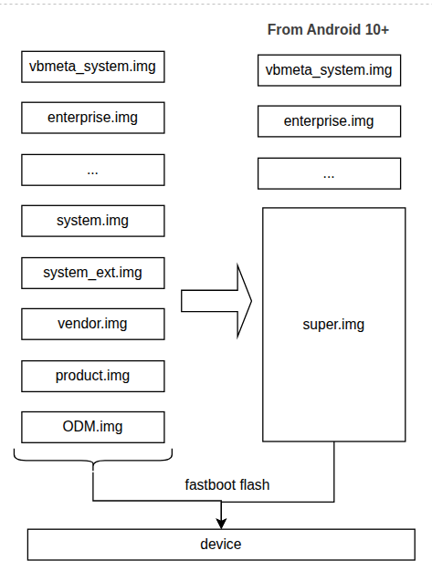

# Partitions

## 1. Parse `super` partition

Tools are built in the source tree:
```bash
export PATH=$PATH:<qssi15>/out/host/linux-x86/bin   # simg2img, lpdump, lpunpack
```

| Step | Command |
|------|---------|
| Convert sparse image to raw | `simg2img super.img super_raw.img` |
| Dump metadata | `lpdump super_raw.img` |
| Unpack sub-partitions | `lpunpack super_raw.img super_unpacked` |

Sample `lpdump` output (short version):
```
Metadata version: 10.2
Metadata slot count: 3
Header flags: virtual_ab_device

Super partition layout:
super: 2048 .. 6720:           odm_a         (4672 sectors)
super: 8192 .. 5962472:        product_a     (5954280 sectors)
super: 5963776 .. 8546072:     system_a      (2582296 sectors)
super: 8546304 .. 9935528:     system_ext_a  (1389224 sectors)
super: 9936896 .. 11739096:    vendor_a      (1802200 sectors)
super: 11739136 .. 11985296:   vendor_dlkm_a (246160 sectors)

Group table:
qti_dynamic_partitions_a  max 6438256640 bytes
qti_dynamic_partitions_b  max 6438256640 bytes
```
- Size of `super`: 6442450944 bytes (6 GB).

## 2. Read a partition
### `vendor_dlkm_a.img` (ext4/erofs image)
```bash
file vendor_dlkm_a.img                              # check filesystem type
mkdir -p vdlkm
sudo mount -o loop,ro vendor_dlkm_a.img ./vdlkm     # mount read-only
ls ./vdlkm                                          # list kernel modules
sudo umount ./vdlkm
```

### `vendor_boot.img`
```bash
unpack_bootimg --boot_img vendor_boot.img --out vboot
```
